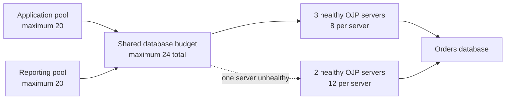
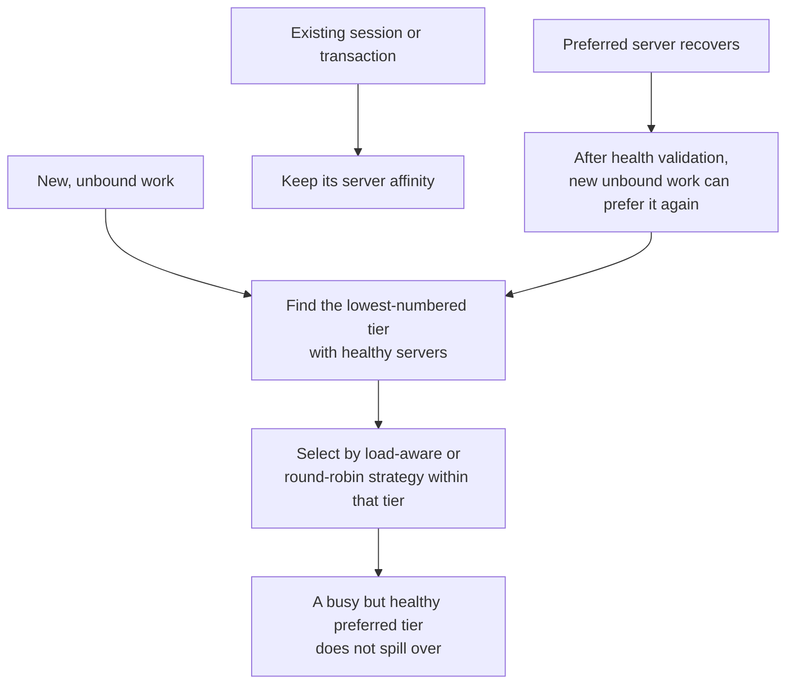

# Open J Proxy 1.1.0: A shared connection budget for a growing world

When an application grows, the number of database connections can grow with it. Add more application instances, give each team its own pool, or introduce a reporting workload, and a database that was comfortable yesterday can suddenly have too many connections today. Open J Proxy (OJP) already puts the real database connection pools on the proxy side. In 1.1.0, we are taking the next step: giving those pools a way to share a connection budget for the database they have in common.

That is the heart of this release, but it is not the whole story. Since 1.0.0, we have also expanded the ways applications can talk to OJP, improved JDBC and ODBC compatibility, made multi-server deployments more flexible, and worked on reliability, security, and documentation.

## One database, one shared budget

Imagine an orders database used by an application and a reporting service. Each has its own pool, and each pool has a maximum of 20 connections. Those settings look reasonable in isolation, but together they allow 40 connections. Add more pools or OJP servers and the total becomes harder to predict. The database does not care which team owns a connection; it has to serve all of them.

With database connection budgets, you can configure a maximum for pools whose JDBC URLs match a pattern. Instead of treating every pool's maximum as an independent promise, OJP allocates capacity from the shared budget. A pool still cannot exceed its own requested maximum, but the budget can give it a smaller share when the combined requests would be too large. If the requested maxima already fit, they are left alone. The budget applies to OJP-managed pooled primary, XA, and read/write replica connections that match the configured pattern.

For example, a budget of 24 connections shared across three healthy OJP servers gives each server a local share of eight connections across its matching pools. If one server becomes unhealthy and the remaining servers have an updated, consistent view of cluster health, their shares can grow to 12 each. OJP adjusts pool allocations as pools come and go and as health information changes. It uses the largest healthy-server count reported by the pools sharing a budget, so one client with a narrower view cannot by itself expand everyone else's allocation. This conservative approach can also delay expansion until the other pools report the smaller count.



Each server's local share is shared across its matching pools, and each pool's own maximum still applies.

You can keep some capacity aside for tools or applications outside OJP with a reserve. You can also give database usernames different weights: when capacity is tight, a username with weight two receives roughly twice the share of one with weight one, subject to pool maxima. Pools using the same username share that username's weight. This gives you a way to express the relative importance of workloads without having to predict every pool's exact size in advance.

The configuration belongs on the server, not in the application's JDBC properties. For example, the following budget matches an orders database, keeps four of 28 connections in reserve, and gives the application a higher weight than reporting:

```properties
ojp.server.databaseBudgets.orders.match.jdbcUrlPattern=jdbc:postgresql://db1:5432/orders*
ojp.server.databaseBudgets.orders.maxTotalConnections=28
ojp.server.databaseBudgets.orders.reserveConnections=4
ojp.server.databaseBudgets.orders.priorities.username.app_rw.weight=2
ojp.server.databaseBudgets.orders.priorities.username.reporting_ro.weight=1
```

Budgets are opt-in. Put the same configuration on every server in a cluster and restart the servers after changes. There are a few important boundaries: unpooled connections and connections made outside OJP are not counted, and the reserve is capacity held back rather than a count of those outside connections. Cluster shares depend on client health reports, not distributed consensus, so a network partition can produce inconsistent views. Shrinking a pool does not terminate active work, which means open connections can take time to fall. The budget does not add another queue or semaphore to the connection borrow path. The [server configuration guide](../configuration/ojp-server-configuration.md#database-connection-budgets) explains the settings and their behavior in more detail.

This is not a replacement for understanding your database's capacity, but it makes that capacity much easier to express across OJP-managed pools. It also complements the existing server-wide limit on concurrent gRPC requests: that limit protects the proxy process, while the new budget is about the database connections behind it.

## More choices for applications

OJP is growing beyond Java. This release adds a C++ ODBC driver with ANSI and Unicode support, giving ODBC applications another path to an OJP server. Its integration coverage spans H2, PostgreSQL, SQL Server, MySQL, and MariaDB, with capabilities including transactions, large objects, session affinity, multi-server behavior, and XA where supported. The work also improves parameterized statements, SQL Server `OUTPUT` result sets, and autocommit switching for ODBC and pyodbc. A preview Windows installer and a Delphi FireDAC guide make it easier to explore ODBC on Windows; the installer is not signed.

There are also early clients for Go, Python, PHP, Ruby, .NET, and Dart. They do not all have the same capabilities: the Go client has H2 coverage through streaming and result-set lifecycle, while the other new clients focus on basic H2 connectivity and CRUD. A new Node.js/TypeScript driver has SQL Server coverage through advanced multi-server, XA, and mutual TLS scenarios, alongside basic H2 coverage. The Node driver is still an MVP, and its TypeORM adapter for PostgreSQL and SQL Server is experimental and not published to npm. Check the individual client documentation before choosing one for a workload; coverage for one database or language does not imply the same support for another.

The clients now share a central gRPC contract, and the client specification describes progressive implementation and integration-test levels. That makes it easier to compare what has actually been exercised and gives future client implementations a common starting point. As with the JDBC driver, applications should avoid adding a client-side pool of OJP sessions: the physical database pool belongs on the server.

## A smoother path through the proxy

For JDBC users running several OJP servers, optional priority tiers can now prefer a nearby server and use other healthy tiers as fallbacks. Lower numbers have higher priority, and normal load-aware or round-robin selection still applies within the chosen tier. Existing sessions and transactions keep their affinity; after a preferred server recovers, new unbound work can return to it. This is strict preference, not automatic spillover when a healthy preferred server is busy, and existing URLs without priorities keep their previous behavior. The [JDBC configuration guide](../configuration/ojp-jdbc-configuration.md#optional-server-priority-in-jdbc-urls) has the URL syntax and deployment details.



Pool acquisition is more forgiving during cold starts. Regular pooled connections, including read replicas, can retry a failed borrow during an additional grace period, which defaults to five seconds and can be disabled. This is not a database login timeout or an end-to-end request deadline, and it does not change XA or unpooled acquisition. The release also preserves XA transaction registries during budget-related pool resizing, so changing an allocation does not unnecessarily disrupt ongoing XA work.

The JDBC driver now supports common PostgreSQL array operations through server-backed objects, preserves PostgreSQL `PGobject` type information when binding values such as JSONB, and handles CLOB access more consistently. It also returns control to JDBC's driver selection mechanism for URLs that do not belong to OJP. ODBC work includes more careful large-object handling and clearer errors for missing parameters. These changes are about the small details that make existing applications behave as expected, not a claim that every database-specific JDBC or ODBC feature is supported.

## Security, delivery, and learning

The release strengthens the path to mutual TLS with client support and integration coverage, including in the ODBC driver. Dependency updates address security issues across Java and Node components, and the Node client replaces some unmaintained dependencies. The server's executable artifact packaging has also been corrected, while release and CI workflows have been improved to make publishing and database-matrix testing more dependable.

We have reorganized the documentation to make it easier to follow a request through OJP and find operational guidance. There is a new DBeaver setup guide, and clearer client capability documentation. The documentation also does a better job of explaining workload fit and known limitations, because a useful proxy is one you can evaluate honestly as well as deploy confidently.

OJP 1.1.0 is about giving teams more room to grow without losing sight of the database they share. Start with a budget that reflects the capacity available to OJP, leave room for everything else, and use the new client and routing options where they fit your deployment. For the complete set of changes since 1.0.0, see the [comparison with main](https://github.com/Open-J-Proxy/ojp/compare/v1.0.0...main).
